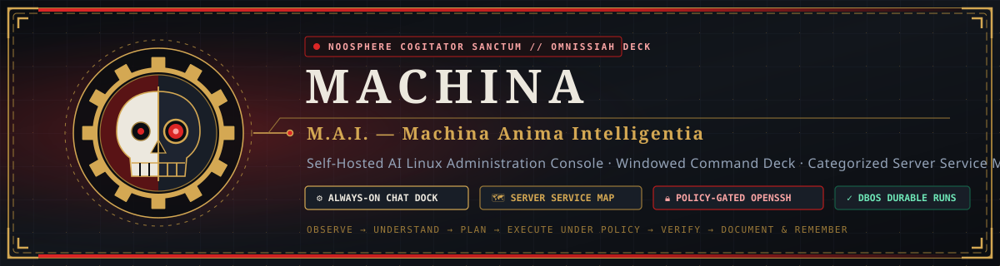
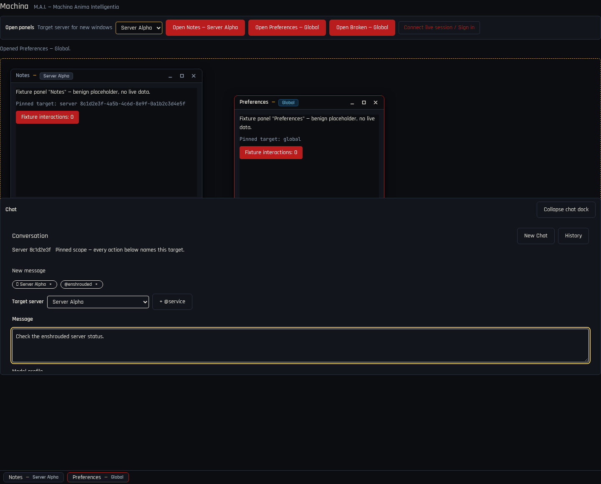
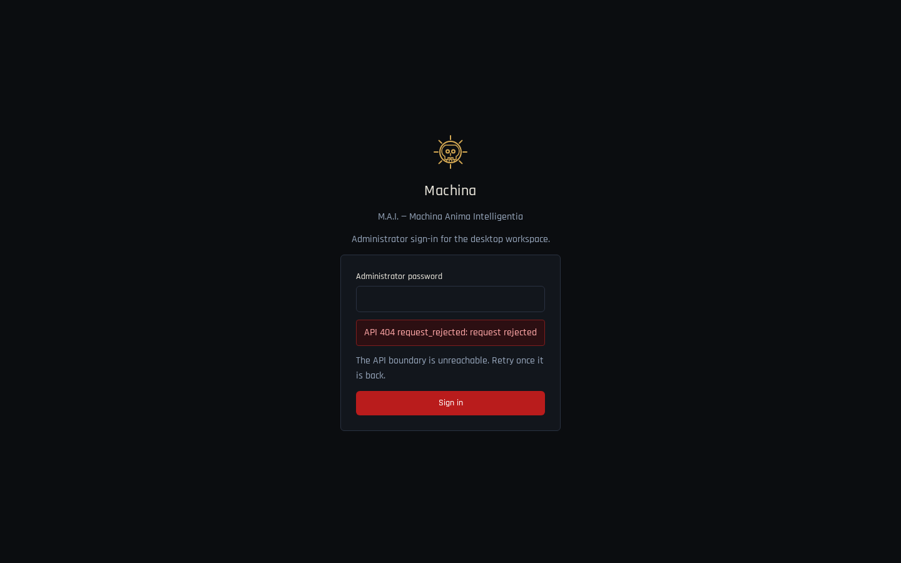

<div align="center">


# Machina — Self-Hosted AI Administration Control Panel

**M.A.I. — Machina Anima Intelligentia**



</div>

Machina is a self-hosted administration control panel for Linux servers. It pairs a Mechanicus-styled desktop windowed web workspace with an approval-gated AI administrator that inspects hosts over OpenSSH, manages Docker Compose applications, investigates incidents, tracks health and security posture, and maintains living operational documentation.

Every action follows an explicit loop:
**Observe → Understand → Plan → Execute under policy → Verify → Document and remember.**

---

## Key Capabilities

- **Always-Visible Bottom Chat Dock:** The console's conversation surface is a dock pinned under the workspace — never a window to lose. Draft context is explicit: a pinned **Server Chip** (following the launcher selection) plus `@service` service chips from an autocomplete over the server's mapped services; both lock immutably the moment a conversation starts, and the **floating history selector** restores past conversations with their recorded scope (`chat.read_session`).
- **Categorized Server Service Map:** Every adopted application renders as one map row with category chips (8 built-ins — `games`, `ai`, `agent`, `system`, `dev`, `infrastructure`, `media`, `observability` — plus operator-minted custom categories), client-side filter pills, one-click **Chat @service** tagging into the dock, and a five-slot operational runbook (install, update, uninstall, backup, verify) recorded through `app.upsert_map_entry`.
- **Desktop-Style Windowed Workspace:** Multi-window SvelteKit interface with draggable, resizable panels for Server Profiles, Capability Policy, Jobs & Schedules, Execution Receipts, Agent Chat & Delegation, Knowledge & Documents, Application Inventory, Plugin Forms, Overview Dashboard, and Memory & Local Models.
- **Supervised SSH Execution & Policy Gates:** Key-only OpenSSH supervision with pinned host-key fingerprints, explicit capability grants (`none`, `narrow`, `broad`), one-use approval tokens for mutating operations, and secret-redacted command receipts.
- **Durable Job Engine & Scheduling:** PostgreSQL-backed (`dbos`) workflows with lease fencing, crash recovery without blind re-execution of dangerous host steps, and cron/interval scheduling.
- **Application Lifecycle Management:** Discover running services, adopt existing stacks, or install/update/remove curated digest-pinned recipes (`example-http.yaml`, `example-stateful.yaml`, `local-inference.yaml`, `odysseus.yaml`) with automatic health-gate rollback.
- **Knowledge, Retrieval & Optional Long-Term Memory:** Markdown document store with `pgvector` + full-text hybrid search, optional SearXNG web search (`--profile search`), and optional Hindsight conversational memory (`--profile memory`).
- **Monitoring, Security Posture & Notifications:** Read-only collectors for system resources, network listeners, processes, cron/systemd timers, SSH/firewall/privilege posture, and package/image updates, feeding a deduplicated findings & notification inbox.
- **Plugins, MCP & Skills:** Extend capabilities via Python entry-point plugins (`mai.capabilities`), stdio or streamable-HTTP Model Context Protocol (MCP) servers, and portable skill packages (`docs/plugins/quickstart.md`).
- **Whole-Instance Backup, Restore & Clean Uninstall:** Checksum-verified backups of PostgreSQL state and canonical files (`scripts/backup-restore.sh`), plus consent-gated host deprovisioning (`scripts/uninstall-host.sh`).

---

## The Machina Workspace

### Command Deck — windows over the Always-Visible Bottom Chat Dock



Operational surfaces live in draggable, resizable windows; the chat dock stays pinned underneath at all times (it is part of the served shell, never a registry window). The dock follows the launcher's server selection, tags conversations with immutable context chips, and survives collapse/expand without losing its transcript.

### Server Service Map — every adopted application, categorized


The Application Inventory panel doubles as the Server Service Map: adopt a discovered stack, categorize it (built-in taxonomy or mint a custom category), describe it, and record its five-slot runbook. Every row then offers one-click **Chat @service** — the conversation opens in the dock pre-scoped to that server and service.

### Machina Login Sanctuary



Single-administrator sign-in under the cog-skull sigil: the setup bootstrap creates the one administrator credential, after which the `/login` sanctuary is the only gate to the workspace.

### Architecture Flow


---

## Requirements

| Component | Requirement |
|---|---|
| **Controller / Target Host** | Linux x86_64 with OpenSSH server, `git`, and root access (`sudo`) for initial host provisioning |
| **Containers** | Docker Engine + Docker Compose v2 (`docker compose version`) |
| **Python Toolchain** | `uv` on `PATH` (manages Python ≥ 3.14 and locked dependencies in `backend/uv.lock`) |
| **Firewall (Optional)** | `ufw` or `firewalld` (when active, the installer adds a single rule scoped to `--controller-address`) |
| **Browser Access** | Desktop Chrome or Firefox via an operator-supplied TLS reverse proxy on LAN or Tailscale |

---

## Quick Deployment (Single-Host Setup)

For the complete runbook and troubleshooting table, see [`docs/operations/quickstart.md`](docs/operations/quickstart.md).

### 1. Clone the repository & generate a controller SSH key

```bash
git clone git@github.com:megastruktur/machina.git
cd machina

ssh-keygen -t ed25519 -f ~/.ssh/mai_controller -N "" -C mai-controller
sudo cp ~/.ssh/mai_controller.pub /root/mai_controller.pub
```

### 2. Preview the installation plan (read-only)

Generate a permanent server UUID and run `scripts/install-host.sh` with `--print-plan` to inspect every account, sudoers file, firewall rule, and container profile before anything is touched:

```bash
SERVER_ID="$(uuidgen)"
echo "Server ID: $SERVER_ID"

sudo bash scripts/install-host.sh \
  --server-id "$SERVER_ID" \
  --data-root /var/lib/mai \
  --public-key /root/mai_controller.pub \
  --grant-scope narrow \
  --controller-address 192.168.1.10/32 \
  --stack-profiles core,worker \
  --print-plan
```

- `--controller-address` must be your admin workstation/controller IP or subnet (`/8` or narrower; blanket rules like `0.0.0.0/0` are refused).
- `--grant-scope` chooses sudo privileges for the `mai` service account: `none` (no sudo), `narrow` (`systemctl start/stop/restart/status docker.service`), or `broad` (`NOPASSWD: ALL`).
- `--stack-profiles` selects which Compose profiles to start: `core` (`postgres`, `mai-api`, `mai-web`), `worker` (`mai-worker` durable job runner), `search` (`searxng` + `valkey`), `memory` (`hindsight`).

### 3. Apply the installation

Re-run with `--yes` (or answer the interactive prompt) to provision the `mai` SSH user, scoped sudoers/firewall rules, mode-`0600` `.env` secrets, Docker Compose services, and canonical server profile under `/var/lib/mai`:

```bash
sudo bash scripts/install-host.sh \
  --server-id "$SERVER_ID" \
  --data-root /var/lib/mai \
  --public-key /root/mai_controller.pub \
  --grant-scope narrow \
  --controller-address 192.168.1.10/32 \
  --stack-profiles core,worker \
  --yes
```

### 4. Verify stack health

```bash
cd backend && uv sync --frozen
.venv/bin/python -m mai.cli status --data-root /var/lib/mai
.venv/bin/python -m mai.cli doctor --data-root /var/lib/mai --env-file ../.env
docker compose --env-file ../.env ps
```

### 5. Attach your TLS reverse proxy

By design, `compose.yaml` publishes **no host ports** (`mai-api:8000` and `mai-web:3000` listen only on the internal `mai` Docker network). Attach your reverse proxy (Caddy, Nginx, Traefik, or Tailscale Serve) to the `mai` network:

- Forward `/api/v1/*` → `http://mai-api:8000`
- Forward all other paths `/` → `http://mai-web:3000`
- Configure `MAI_PUBLIC_ORIGINS` (e.g. `https://mai.lan.example`) and `MAI_TRUSTED_PROXIES` on `mai-api` (see [`docs/operations/quickstart.md`](docs/operations/quickstart.md) §6).

### 6. Bootstrap the administrator password (one-shot)

On first boot, MAI starts in setup state. Initialize the single administrator credential via the web UI or `POST /api/v1/auth/bootstrap`:

```bash
curl -fsS -X POST https://mai.lan.example/api/v1/auth/bootstrap \
  -H 'Content-Type: application/json' \
  -d '{"password": "<your-strong-admin-password>"}'
```

Once created, `POST /api/v1/auth/bootstrap` is permanently locked (`409 Conflict`) and you can sign in at your configured origin.

---

## Day-2 Operations & CLI Reference

All operator commands run through `python -m mai.cli` (or the scripts in `scripts/`) and never print secret values to stdout/stderr:

### Operator CLI (`mai.cli`)

```bash
# Inspect global or per-server canonical state
python -m mai.cli status --data-root /var/lib/mai
python -m mai.cli status --data-root /var/lib/mai --server-id "$SERVER_ID"

# Run integrity and permission diagnostics
python -m mai.cli doctor --data-root /var/lib/mai --env-file .env
```

Subcommands: `bootstrap`, `doctor`, `status`, `backup`, `restore`, `uninstall`, `admin write`, `admin delete`.

### Managing Optional Compose Profiles

```bash
# Start background job & schedule worker
docker compose --profile worker up -d

# Start SearXNG + Valkey web search stack
docker compose --profile search up -d

# Start Hindsight conversational memory stack
docker compose --profile memory up -d
```

### Backup, Verify & Restore ([`docs/operations/recovery.md`](docs/operations/recovery.md))

```bash
# Create a checksum-pinned backup bundle (Postgres + canonical data root, zero plaintext secrets)
bash scripts/backup-restore.sh backup \
  --data-root /var/lib/mai \
  --env-file .env \
  --output /var/backups/mai-backup.tar.gz

# Verify bundle checksums and manifest integrity
bash scripts/backup-restore.sh verify /var/backups/mai-backup.tar.gz

# Restore into a fresh instance
bash scripts/backup-restore.sh restore /var/backups/mai-backup.tar.gz \
  --data-root /var/lib/mai
```

### Key Rotation & Uninstall ([`docs/operations/uninstall.md`](docs/operations/uninstall.md))

```bash
# Preview teardown plan
sudo bash scripts/uninstall-host.sh \
  --data-root /var/lib/mai \
  --keep-data \
  --print-plan

# Deprovision MAI-owned host access/containers while preserving /var/lib/mai
sudo bash scripts/uninstall-host.sh \
  --data-root /var/lib/mai \
  --keep-data \
  --yes
```

---

## Repository Structure

| Path | Description |
|---|---|
| `backend/` | FastAPI + DBOS controller package (`mai`): API routes, auth, capability policy, SSH supervision, durable jobs, knowledge/retrieval, memory, monitoring, notifications, plugins |
| `frontend/` | SvelteKit windowed desktop workspace (`mai-web`) and Playwright test suites (`frontend/tests/`) |
| `compose.yaml` | Container topology: `postgres`, `mai-api`, `mai-web` + profile-gated `mai-worker`, `searxng` + `valkey`, `hindsight` |
| `catalogue/` | Curated application & model recipes (`example-http.yaml`, `example-stateful.yaml`, `local-inference.yaml`, `odysseus.yaml`) |
| `scripts/` | Operator tooling: `install-host.sh`, `backup-restore.sh`, `uninstall-host.sh`, `runtime_check.py` |
| `deploy/` | Service deployment notes (`deploy/hindsight/README.md`) and SearXNG configuration (`deploy/searxng/settings.yml`) |
| `docs/operations/` | Operator runbooks: [`quickstart.md`](docs/operations/quickstart.md), [`recovery.md`](docs/operations/recovery.md), [`uninstall.md`](docs/operations/uninstall.md), [`acceptance.md`](docs/operations/acceptance.md) |
| `docs/plugins/` | Plugin, MCP & skill author guide: [`quickstart.md`](docs/plugins/quickstart.md) |
| `docs/architecture/` | Architecture contracts (`docs/architecture/contracts.md` C01–C11) and subsystem ADRs |
| `docs/assets/` | Mechanicus SVG artwork and README screenshots (produced by `frontend/tests/capture-readme-screenshots.spec.ts`) |
| `tests/` | Cross-cutting runtime (`tests/runtime/`) and documentation-consistency (`tests/docs/`) suites |

---

## Development & Verification

```bash
# Backend unit & integration tests
cd backend && uv sync --frozen
.venv/bin/python -m pytest ../tests/docs/test_docs_consistency.py -v

# Frontend typecheck & Playwright component/workspace tests
cd ../frontend
pnpm run check
pnpm exec playwright test
```

`tests/docs/test_docs_consistency.py` automatically verifies that every CLI subcommand/flag, script flag, Compose profile, recipe, repo path, relative link, and `/api/v1/` endpoint in `README.md`, `docs/operations/`, and `docs/plugins/` matches the live codebase.

---

## Scope & v1 Limitations

- **No bundled TLS proxy or published ports:** `compose.yaml` binds internal networks only; expose the UI over LAN or Tailscale behind your own TLS proxy.
- **Single administrator, Linux-only:** Designed for one administrator managing Linux hosts over OpenSSH (Windows/macOS targets and multi-tenant RBAC are out of scope for v1).
- **In-app notifications:** Monitoring collectors and the notification inbox are active; external pager/messenger webhooks are not armed by default.

---

## License

MIT License — see [`LICENSE`](LICENSE).
Third-party container images (`pgvector`, `searxng`, `valkey`, `hindsight`, `ollama`) retain their respective upstream licenses.
