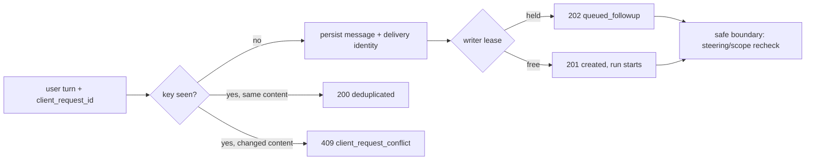

# Agent-task continuity — conversation and task contracts (act addendum)

> **HISTORICAL (D09, 2026-11-06).** The conversation/task contract modules this
> addendum owns (`contracts/conversations.py`, `contracts/tasks.py`) and every
> producer/UI surface below were removed with the session-first cutover
> (migration `0015` dropped the schema). The session-first vocabulary —
> `contracts/sessions.py` (`sessions`/`session_runs`/`session_entries`), the
> cursor WebSocket channel and the `/api/v1/agent-sessions/**` routes — is the
> sole conversation/history authority; see `contracts.md` §"D09 supersession".
> This document is kept as the frozen act-campaign record.

- **Card:** `01-contracts` (act campaign "agent-continuity", feature worktree
  `act-foundation`)
- **Status:** ratified addendum. This document integrates the campaign
  contract draft (`act_CONTRACTS.md` §1–§12) into the product architecture as
  the authoritative vocabulary for conversation/task continuity. The frozen
  P00 contracts in [contracts.md](contracts.md) (C01–C11) remain fully
  binding; nothing here relaxes them. Existing grants, approval checks and
  the DBOS run lifecycle are preserved unchanged.
- **Code owners (source of truth for every name below):**
  `backend/src/mai/contracts/conversations.py` (conversation identity,
  transcript, submission, steering, intake union, pagination) and
  `backend/src/mai/contracts/tasks.py` (task vocabulary, plan patches,
  completion verdicts, phase/revision/scope checks). Both modules are pure
  and value-free in errors. Producers implement against them; siblings never
  redefine these names (act_CONTRACTS §11).

## 1. Identity and authoritative state

| Identity | Contract |
|---|---|
| `conversation_id` | Stable UUID for a chat, independent of its last run. Pins principal visibility and server scope; switching servers creates another conversation, never a silent retarget. |
| `message_id` | UUID plus conversation-local monotonic `sequence`. UI-authored `client_request_id` deduplicates retransmission; same key with changed content is `client_request_conflict`. Assistant/tool roles are created only by trusted producer paths — intake payloads carry no writable role field. |
| `task_id` | UUID for a goal episode, stable across runs. V1: one active task per conversation; completed tasks stay historical. `new_task` creates a new episode explicitly; ambiguous goal switches are proposed, never silently applied. |
| `run_id` | The existing durable execution attempt (C05). Multiple runs contribute to one task. DBOS checkpoints own model/tool history; app-owned tables own user-visible domain state. No second scheduler; HTTP readers never reach into DBOS private tables. |
| `revision` | Optimistic concurrency token for task/plan changes, incremented transactionally. Stale writes surface the structured `revision_conflict` vocabulary — never last-writer-wins. Messages/events stay append-only; corrections create new revisions, not overwrites. |

One conversation writer/executor lease at a time (coordinated through the
existing resource-lock layer, C05 rule 6). Snapshot reads may be concurrent;
an exclusive write against a held lease is `conversation_busy`; message
follow-ups are admitted and queued against the active writer.

## 2. C05 task-body privacy resolution

The C05 question — what durable task and transcript bodies may carry versus
what run-scoped telemetry sees — is resolved as follows:

- **Raw-secret exclusion happens before persistence or model forwarding.**
  The contract models have no field that can carry a credential value:
  credentials resolve by reference only (C03 rule 6), and verdict
  `result_data` rejects credential-shaped keys outright.
- **Durable conversation/task storage** (migrations owned by cards 04/11)
  stores bounded, sanitized bodies with content provenance. A transcript row
  may carry text inline (bounded) or a safe out-of-band `content_ref`
  instead; `redacted` marks deliberately redacted rows, for which no
  textual-fidelity claim is made — the safe provenance and an explanation
  replace the original.
- **Run-scoped telemetry** (events, receipts, engine tables) keeps only
  content IDs, revisions and safe references. Transcript content is never
  copied into generic job-list or event payloads (C05 rule 4 envelope
  discipline, including its secret-key guard).
- **Retention/deletion** follows the existing authorized data policy.
  Deleting a chat does not claim to erase engine audit or backups; that
  requires a separately verified retention design. Content endpoints are
  scoped by server/conversation and never become cross-server prompt export.

## 3. Submission, steering and continuity

Proposed content-aware surface (routes mount under the existing `/api/v1/`
prefix; producer cards 05/07/08 own the actual `chat` router writes):

- `POST /conversations` — `{server_id, client_request_id, message, profile,
  requested_phase}` → `{conversation_id, message_id, task_id, run_id,
  revision, disposition}`.
- `POST /conversations/{id}/messages` — same shape plus
  `expected_revision` and `task_action: continue|new_task`.
- `GET /conversations`, `GET /conversations/{id}` — safe metadata header
  with `history_completeness` (and the missing range when incomplete).
- `GET /conversations/{id}/messages` — role-preserving sanitized page,
  ordered by `(sequence, message_id)`, same-filter `total`.
- `GET /conversations/{id}/events` — resumable monotonic events via the
  existing SSE/auth transport (C08 rule 7); payloads reference content IDs,
  never raw confidential prompts.

Dispositions and their HTTP statuses: `created → 201`,
`deduplicated → 200`, `queued_followup → 202`. Submit deduplication:
same `client_request_id` + same content fingerprint deduplicates; same key +
changed content is `client_request_conflict`.

Explicit control is deterministic: `steer | pause | cancel`. Pause/cancel are
recorded immediately and carry no planner input (the contract model rejects a
message on them); natural-language steering is interpreted at the next safe
boundary and displayed as pending until applied. Before each new tool effect
— including between calls in a batch — steering and scope are rechecked. A
backend/model restart never reruns successful intake or effects; profile
switching applies to the next allowed model call while preserving task,
context and grants.

## 4. Structured intake (`TurnInterpretation`)

The planner emits one checkpointed discriminated union per accepted user turn
(`extra="forbid"` everywhere; unknown fields are rejected, never ignored):

| Variant | Purpose | Required |
|---|---|---|
| `answer` | Compact self-contained answer (P1: no artificial todo, no second action call). | `answer_text` |
| `clarify` | Ask the user. | ≥ 1 `open_questions` (stable proposal IDs) |
| `plan` | Propose a task: objective, measurable criteria, constraints, bounded patch. | `objective`, criteria, `todo_patch` |
| `continue_task` | Delta against the current plan — never whole-list replacement, never a goal change. | `todo_patch` |
| `new_task` | Explicit new episode (`rationale`, optional `prior_task_id`). | criteria, `todo_patch` |
| `blocked` | Cannot proceed safely (missing prerequisite/authority, ambiguous scope, dependency out). | `reason`, `blocked_kind` |

Shared fields: `schema_version`, `source_message_id`,
`expected_task_revision`, `understanding` (short), bounded `open_questions`.
Facts are sourced references; assumptions are separate and explicitly
unverified. No provider chain-of-thought is captured.

**Authority boundary (binding):** the schema contains NO writable `approved`,
`grants`, `execute_now`, `bypass_approval`, credential values, observed
completion timestamps or verified outcomes. Those are injected read-only
facts from trusted services; `extra="forbid"` makes them unrepresentable at
every nesting level. Frozen bounds: max 12 steps per patch, ≤ 240 chars
title, ≤ 1000 chars summary/rationale, ≤ 16 KiB serialized patch. Initial
recommendation stands: one structured-output model call per accepted user
turn; a model without validated structured output is unavailable for
action-intake, never a reason to execute unstructured prose.

## 5. Validation and authority

Deterministic checks live in the contract modules and run before anything
durable happens (scenario P4): schema and lengths, duplicate step keys,
dependency DAG cycles, add-collisions, unknown dependency/supersede/evidence
references (against live scope — fail closed), executed steps without
evidence, constraint escalation, revision CAS, phase admission, completion
coverage. 'Source exists' is provable; semantic entailment is not — the UI
shows original wording beside interpretations with uncertainty.

Phase is chosen by explicit UI/control state and stays advisory:
`metadata_update` and `plan_proposal` are legal in every phase;
`collect_evidence` in `inspect|act`; `execute_steps` only in `act` (still
subject to existing grants and the C03 approval checks — plan review narrows
permission, never bypasses it). A model-origin proposal can never supersede a
USER-origin constraint (`constraint_escalation`); user corrections go through
the revision API. Model claims of user approval create no approval events.

## 6. Task vocabulary and completion

- Plan steps carry stable IDs, frozen statuses
  `pending|in_progress|blocked|executed|skipped` and a separate verification
  field `not_checked|passed|failed|unavailable` bound to evidence. UI renders
  "done" only from agreed checks, never from a model-ticked boolean; `skipped`
  records a reason and satisfies no acceptance criterion.
- `UnderstandingSnapshot` is the bounded task model: goal, requested phase,
  active constraint references (critical constraints verbatim, never silently
  truncated), next actions with counts/continuations. `TaskView` exposes the
  header plus list counts — items/constraints/evidence are explicitly
  paginated collections (`GET /tasks/{id}/items` and siblings); there is no
  unbounded "load whole task" helper.
- `TaskCompletionVerdict` is the compact §9 receipt: `execution_status`,
  `domain_outcome` (honestly `unknown` for arbitrary shell work),
  `effect_certainty`, `error_code`, bounded `result_data`, retry hint,
  evidence and the requirement-result map. `verified` is never self-granted:
  every acceptance criterion must be covered by a passed result bound to
  evidence, else `completion_missing_evidence`. User-authorized check scope
  bounds verification: a verify step cannot spend money or touch live
  services beyond its grant.
- Tool identifiers for later cards: `task.read`, `task.propose_update`,
  `task.update_item`, `task.propose_completion` — one shared task service
  behind tools and HTTP; ToolContext derives conversation/task/server from
  bound run identity, never from the model.

## 7. Pagination contract

Every collection endpoint, agent tool and panel loader is paginated
(AGENTS.md invariant): `DEFAULT_PAGE_LIMIT = 50`, `MAX_PAGE_LIMIT = 200`,
envelope fields `limit`, `offset`, `total`, `has_more`, deterministic
ordering, and `COUNT(*)` under the same filter. `has_more` is derived, never
fabricated: `offset + len(items) < total` (validated in the page envelope).

## 8. Legacy compatibility and history completeness

Recovery only from app-owned authoritative payloads where original role and
scope are provable; browser-reconstructed legacy Markdown stays labelled
`legacy_import`, never synthetic verified user turns. No HTTP endpoint
unpickles DBOS private state. Where safe recovery is impossible, readers
return `history_completeness = partial|unavailable` plus the missing range,
and mutations are refused with `history_reconstruction_incomplete` until the
user explicitly confirms scope; a user-confirmed recap becomes a new explicit
message and never fabricates old approval. Tests for downstream cards must
cover deep chains, cycles/bad parent links, cross-server references, browser
refresh, lost frontend cache and recorded placeholders — unknowns stay
explicit, never converted into model input.

## 9. Error-code registry (stable, C01 envelope)

| Code | Module | Raised by |
|---|---|---|
| `conversation_busy` | conversations | write against a held writer lease |
| `client_request_conflict` | conversations | idempotency key reused with changed content |
| `conversation_not_found` | conversations | unknown or out-of-scope conversation (C8: existence never leaks) |
| `history_reconstruction_incomplete` | conversations | mutation over unconfirmed partial/unavailable history |
| `task_not_found` | tasks | unknown or out-of-scope task (C8) |
| `revision_conflict` | tasks | stale `base_revision` on CAS |
| `invalid_task_patch` | tasks | any structural patch violation (dup keys, cycles, unknown refs, …) |
| `phase_not_allowed` | tasks | action not admitted in the task's phase |
| `completion_missing_evidence` | tasks | completion claimed without evidence-bound criterion coverage |

Field-level detail codes (e.g. `duplicate_step_id`, `dependency_cycle`,
`unknown_evidence_ref`, `constraint_escalation`) ride in the envelope's
`fields` mapping; error strings stay value-free.

## 10. Ownership and change control

Contract/schema: this card (01) owns the two modules plus this document.
Persistence migrations: 04 then 11. Runtime suite/fixture lifecycle: 00.
`api/chat.py` writes: 05/07/08 sequential; `agents/run.py`: 02/03/06/07/13/20.
Typed client wrappers: 09/16; generated API schema is regenerated by every
route/model producer before its slice completes. The frozen P00 sections
(C01–C11) keep their own change control; changes to THIS addendum follow the
campaign reconciliation rule (act_CONTRACTS §11–§12): central rename, briefs
updated, no sibling redesigns, material findings pause for reconciliation.

## 11. Runtime v2 compatibility (rv campaign, 2026-11-01)

The authoritative Runtime v2 contract is
[docs/architecture/runtime-v2.md](runtime-v2.md). Sections 1–10 above remain
binding for legacy conversations and for everything not superseded there. What
changes for **v2 conversations only**:

1. **Structured intake is legacy-only.** The §4 `TurnInterpretation` planner
   union and its one-repair loop run ONLY inside the frozen legacy
   `agent.run` handler. A v2 conversation submission goes directly to the
   working model (no intake call, no mandatory todo); the §4 authority
   boundary (no writable approval/grant fields, model proposals never
   supersede USER constraints) carries over as design discipline for every
   v2 model-facing surface.
2. **Progress projection.** The §6 task vocabulary stays authoritative for
   legacy conversations and evidence-bound completion; v2 conversations
   project progress through the work journal with an OPTIONAL advisory
   checklist (runtime-v2.md §8). `TaskCompletionVerdict` semantics
   (`completion_missing_evidence`) are reused by v2 unchanged.
3. **Objectives instead of one-task-per-conversation.** §1's
   "one active task per conversation" rule is superseded for v2 by explicit
   objective episodes with operator-owned server scope (runtime-v2.md §3);
   legacy conversations keep §1 semantics read-only.
4. **Identity, lease, privacy, pagination unchanged.** §1 identity/lease
   rules, §2 privacy resolution, §3 submission/steering dispositions and the
   §7 pagination contract (50/200, `has_more` derived) bind v2 verbatim.
   State-specific resume semantics for v2 are frozen in runtime-v2.md §9.
