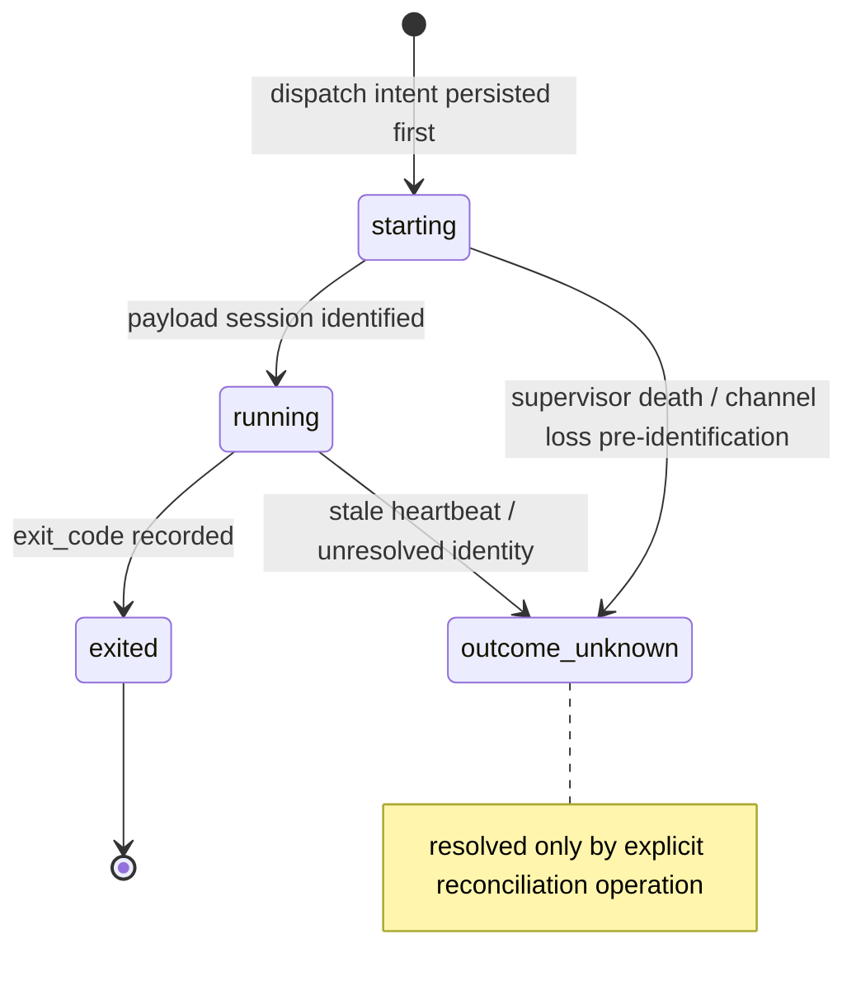

# MAI shared technical contracts — frozen P00

- **Card:** `mai-00-contracts` (P00 · service `contracts` · documentation-only)
- **Status:** FROZEN P00 output. This document consolidates the P00 architecture
  decisions into the authoritative cross-module contracts. It becomes binding on
  implementation phases at the P00 phase gate. Changes after freeze require
  coordinator reconciliation (`mai_EXECUTION.md` §3); silent edits are prohibited.
- **Precedence:** for each topic below, the named frozen P00 ADR governs its details;
  this document governs the cross-module vocabulary and the interfaces between those
  decisions. Where the draft inputs (`mai_CONTRACTS.md`, `mai_UI_WORKSPACE.md`) or
  `IDEA.md` conflict with a frozen ADR or this document, the frozen document governs.
- **Naming rule:** route names, field names, module paths and scenario fixtures below
  are frozen design targets for their named producer cards. No name here is an
  existing repo symbol. Renaming requires reconciliation of this document and its
  consumers (auth ADR §10 pattern).

## Frozen inputs (exact provenance)

| Document | Integrated at (SHA) | Governs |
|---|---|---|
| `docs/architecture/runtime-environment.md` | `89b6532cdd51dc4abdbfdf6a1d5b723e2769dcf9` | disposable targets, fixtures, toolchain rules (§C10) |
| `docs/architecture/auth-and-origin.md` | `3e79449b1a7b661c6773f13203ff13f5334e2a80` | identity, session, CSRF/origin, TLS/exposure, G1/G2 (§C08) |
| `docs/architecture/knowledge-packaging.md` | `5d6e0a1` + fix-round-1 `563fccb` (pg_trgm owed-confirmation reword) | Hindsight, SearXNG, embeddings, pgvector (§C07) |
| `docs/architecture/windowed-workspace.md` | `e2cde76b0067d42892688c56c2b1c82d1084ac31` | windowed desktop UI (§C11) |
| `docs/architecture/job-engine.md` | `bc8d264b1fb83061112cb7d61bcecfee459f5d15` | DBOS durable engine + 10 guard rules (§C05) |
| `docs/architecture/host-supervision.md` | `1ce8181aa7783428197ae3ab79e19b687de6bfda` | target-side command ownership + receipt contract (§C04) |

Draft inputs consolidated (not authoritative after this freeze): `mai_CONTRACTS.md`
(C01–C10), `mai_UI_WORKSPACE.md` (C11 draft). Service rows and the end-to-end
execution route referenced here are from `mai_SERVICES.md` (§"Services ownership map").

**Consumer rule:** implementation tasks read only the sections named in their brief
plus the ADR sections those sections cite — not the whole programme. Weak-model tasks
receive only their relevant sections and the fixed fixtures of §"Frozen fixtures".

---

## C01 — identities, API envelope and ownership

Normative rules:

1. Opaque stable UUIDs are the only identity: `server_id`, `application_id`, `run_id`,
   `step_id`, `approval_id`, `event_id`, and (view layer) `window_id` (§C11). Display
   name, IP address or label is never identity.
2. Every operation receives an explicit `server_id`. The API obtains the principal from
   the authenticated session only — never a user-supplied admin flag, role header or
   query parameter (frozen by auth ADR `3e79449` §2: forged `X-Admin`-style headers are
   not authorization inputs).
3. Structured API error envelope (stable shape for all `/api/v1` errors):

   ```json
   { "error": { "code": "origin_rejected", "message": "request origin is not allowed",
                "request_id": "b39a1c…", "fields": {} } }
   ```

   `code` is a stable string (`unauthenticated`, `csrf_rejected`, `origin_rejected`,
   `request_rejected`, `throttled`, `conflict`, `validation_failed`, …); `message` is
   safe for browser display; no traceback, stack frame or secret material ever appears.
   Auth codes and behavior are frozen by auth ADR §5.
4. API prefix is `/api/v1` (auth ADR §1). All endpoint paths in task briefs are design
   targets to implement, not verified existing routes.
5. Timestamps are stored UTC; every schedule/user-facing time display carries an
   explicit timezone (engine rule 7: `cron_timezone`, default UTC). List endpoints are
   bounded/paginated.
6. Mutable canonical records carry a version/revision; a stale write conflicts
   (structured `conflict`) rather than silently clobbering (§C02 revision semantics).
7. Server context is enforced in queries and job binding at the storage/service
   boundary — default shared retrieval is never unfiltered multi-server access
   (§C07 rule 2, §C05 lock keys, §C11 pinned scope).

Ownership: error-envelope and identity rules are consumed by every API router; the
auth boundary (`02-auth-api`), job facade (`05-jobs-api`) and projection writers
(`02-profile-projection`) implement them; no card may add a bypass route (SERVICES
"End-to-end execution route": no alternate shell backdoor in a web route, MCP bridge,
cron path or child agent).

## C02 — canonical files and SQL projections

Normative rules:

1. The data root is configured explicitly; default controller-host `~/.mai/`. The
   service user owns writable subtrees with restrictive permissions. The controller
   container's HOME is never inferred to be a target host's HOME.
2. Canonical path scheme: `servers/<server_id>/profile.yaml`, `servers/<server_id>/prompt.md`,
   `servers/<server_id>/applications/<application_id>/manifest.yaml`, plus docs/runbooks.
   Exact file field schemas are frozen at P00/P02 by `02-profile-schema` /
   `02-profile-projection` against this section.
3. Paths resolve only from opaque ID + approved root. Traversal, symlink escape,
   invalid IDs and absolute user-supplied paths are rejected for canonical writes.
   Referenced external deployment paths are separate validated metadata — never
   another canonical manifest.
4. Canonical version = file content revision + schema revision + content hash. The
   Postgres projection stores the same revision. Atomic file replace does NOT make the
   file+SQL pair atomic.
5. Write journal/outbox phases (frozen shape): `prepared intent -> file committed ->
   projection reconciled`. Recovery reads file hash/revision; no invented successful
   sync. Deletion has a tombstone/purge path. Crash semantics below are binding before
   `02-file-store` implementation.
6. Server prompt additions are admin-controlled, versioned (auth ADR §C08 selector
   rule); they are not LLM-generated by default. Generated operational docs use a
   separate namespace (§C07 rule 5).

**Crash windows — reconciliation map (frozen design evidence, tabletop 2026-10-12,
author evidence `mai_evidence/00-contracts/02-tabletop.md`):**

| # | Crash window | Contract behavior |
|---|---|---|
| W1 | crash after `prepared intent`, before file commit | intent row exists, file unchanged; recovery re-executes or discards the intent by comparing file hash/revision; no half-written file is visible (atomic temp+rename) |
| W2 | crash after file commit, before projection | file is authoritative; recovery reconciles projection from file hash/revision; UI reads projection only after reconcile, or shows `stale` (§C08 rule 4) |
| W3 | crash during projection write | Postgres transactionality bounds the window; projection row either old or new revision, never mixed |
| W4 | delete with projection write pending | tombstone first, purge after projection confirms; a resurrected file with a live tombstone is a conflict surfaced to the admin, not silent overwrite |

## C03 — capabilities, credentials and policy

Normative rules:

1. `CapabilityDescriptor`: identifier, version, config/input/output schemas, supported
   execution environments, effect class, declared resource scope, required grants.
   Field names above are the frozen vocabulary; JSON examples are frozen by
   `03-capability-registry` against this section.
2. `ExecutionContext`: principal, `server_id`, `run_id`, parent scope,
   profile/prompt revision, credential references, allowed capabilities, mode. Secret
   values are NEVER serialized into an `ExecutionContext`.
3. Effective child grants are an intersection/subset (never a union with child profile
   defaults). Grants, server adoption and current policy are rechecked immediately
   before any privileged effect (auth ADR §8 G2 step 4).
4. Approval binding: an approval binds operation **payload hash**, server/target,
   scope, current policy revision and expiry. Changing any of these invalidates the
   approval — one decision can never approve an arbitrary follow-up command.
   Tabletop (design evidence, `02-tabletop.md`): altered payload hash ⇒ deny + new
   approval required; altered target ⇒ deny; expired ⇒ deny; revoked policy revision
   ⇒ deny. Runtime negative control is owned by `03-approval-api`/`03-dispatcher`
   (P03 gate).
5. Modes `ask` and `delegated` change prompting behavior within grants; `deny` takes
   precedence everywhere. Raw shell/root capability is explicitly broad: enabling it
   forfeits app-level OS containment claims.
6. Credentials resolve from `.env` as the mandatory first resolver; 1Password is an
   optional later plugin (auth ADR §11). Names resolve only from the configured
   source; host-wide secret scanning is prohibited. Output redaction is
   defense-in-depth, never proof that a root-capable model cannot see secrets.
7. Native Python plugins are trusted installed code (v1); MCP tools carry independent
   grants and server scope. Plugin validation is not sandboxing. No installation-time
   auto-grant exists (SERVICES decision-dependency row).

Ownership: `03-capability-registry`, `03-policy`, `03-credentials`, `03-dispatcher`;
consumers: every executor path (§C04), agent bridge (§C06), jobs facade (§C05).

## C04 — SSH execution and remote outcomes

Normative rules (transport frozen by host-supervision ADR `1ce8181`):

1. Target profile determines SSH host key, endpoint/user, environment/shell, privilege
   mode. A changed host key is rejected; there is no silent auto-trust on reconnect
   (host rule 5, measured exp4b; negative control AUTH-S4-class: re-enrollment is an
   explicit admin action recording the new fingerprint).
2. Linux command inputs are structured argv/environment where possible; shell strings
   pass only through the explicit shell capability. Credentials are never concatenated
   into shell or argv.
3. `CommandRequest` (frozen shape): `op_id` (opaque UUID, §C01), target `server_id`,
   safe display string, timeout, output budget, working-directory policy, privilege
   request, recovery classification. Transport representation: dispatch over SSH with
   a **target-local supervision wrapper plus durable receipt directory** established
   before the effect (measured variant), or a `systemd-run` transient unit carrying
   the same receipt contract on systemd targets — **boundary-verify the systemd
   variant before it is load-bearing** (host rule 6, open item SSH-SYSV1 in
   `runtime-scenarios.md`). No new privileged network daemon on targets; the SSH
   session is never the owner (host rule 1).
4. `CommandOutcome` status enum is **frozen at contract level** (P04/P05 schema
   producers implement exactly these values; additions require reconciliation):
   `succeeded | failed | running | outcome_unknown | cancel_requested | cancelled`.
   Outcome carries: exit status where known, bounded/redacted output references,
   timestamps, target boot identity/process supervisor handle if applicable.
5. Dispatch intent is persisted before submission. An effect can occur before its
   receipt: a missing receipt is `outcome_unknown`, never retry-safe (host rule 3,
   job-engine rule 2).
6. Cancellation accounts for the whole descendant ppid-closure and package-manager
   critical sections; requested cancellation is not verified cancellation. `cancelled`
   is reported only after host-verified termination (receipt exit record, e.g.
   `143`); the UI/API never reports "cancelled" before host or engine verification
   (job-engine rule 3, host rule 2).
7. SSH channel liveness is not command progress. Lease expiry never authorizes a
   duplicate mutation while a prior process may live; fence/lock policy reconciles
   active target work before replacement (§C05 locks).

**Receipt contract (frozen verbatim from host-supervision ADR §"Receipt contract";
`04-supervisor`/`04-ssh-connect` implement, `04-reconcile` consumes):**

Per operation `<op_id>`, one directory under a durable service-owned target path
(real hosts e.g. `/var/lib/mai/receipts/`): `state` (atomically replaced; keys `op_id`,
`seq` monotonic, `state ∈ starting|running|exited`, `ts` UTC, `boot_id`,
`wrapper_pid`, `payload_pid`, `payload_startticks`, `exit_code` on `exited` only),
`events.log` (append-only transitions + per-second `hb payload_pid=…` heartbeats +
reconciliation notes), `stdout.log`/`stderr.log` (bounded).

Identity rule: a receipt names a live process only if `/proc/<payload_pid>/stat`
exists AND field-22 start ticks equal `payload_startticks`. Mapping to §C04 statuses:
`exited`+0 → `succeeded`; `exited`+≠0 → `failed`; `running`+fresh heartbeat+resolving
identity → `running`; `running`+stale heartbeat or unresolved identity →
`outcome_unknown`; `cancel_requested` is controller-recorded until host-verified
`cancelled`. Reboot/recreate classification is **derived** from stale state +
unresolved identity + observed restart — never hardcoded (host rule 4; `boot_id` and
`/proc/uptime` do not move on container restarts; container targets need control-plane
instance identity `Id`+`StartedAt` or an instance-epoch file).

State machine (receipt `state` field):



Example `state` file (good — complete exited receipt):

```ini
op_id=7d1c…
seq=4
state=exited
ts=2026-10-12T10:31:07Z
boot_id=3f2e…
wrapper_pid=812
payload_pid=834
payload_startticks=1847
exit_code=143
```

Bad examples: `state=running` with `exit_code` present (invalid — `exit_code` only on
`exited`); missing `payload_startticks` (identity guard unusable ⇒ treat as stale);
`state=cancelled` (invalid — the receipt never says "cancelled", host-supervision ADR).

## C05 — runs, steps, schedules and shared locks

Normative rules (engine frozen by job-engine ADR `bc8d264`; DBOS `dbos==3.2.0` is the
durable engine, fallback NOT triggered):

1. The application facade owns the domain run API (`backend/src/mai/jobs/` proposal);
   engine vocabulary stops at one adapter. There is no second scheduler and no hidden
   queue outside DBOS queues. DBOS tables in Machina's Postgres are the canonical
   runs/steps/events ownership map (SERVICES "Runs, steps, approvals, events" row).
2. Run lifecycle (frozen state machine; engine mapping from job-engine ADR
   "Responsibility split"):

   ```mermaid
   stateDiagram-v2
       [*] --> queued : submit (idempotency key = workflow id)
       queued --> running : engine PENDING
       running --> waiting_approval : capability requires ask-decision
       running --> waiting_children : delegation children pending
       running --> reconciling : outcome_unknown effect present
       waiting_approval --> running : approval granted
       waiting_children --> running : children resolved
       reconciling --> running : reconciliation resumes
       reconciling --> failed
       running --> succeeded
       running --> failed
       running --> cancelled : cancel_requested until engine CANCELLED
       queued --> cancelled
       queued --> failed
       succeeded --> [*]
       failed --> [*]
       cancelled --> [*]
   ```

   Engine map: `queued`=ENQUEUED, `running`=PENDING, `succeeded`=SUCCESS,
   `failed`=ERROR, `cancelled`=CANCELLED. `waiting_approval`/`waiting_children`/
   `reconciling` are application-level states; `cancel_requested` is facade-recorded
   until the engine reports CANCELLED. Paused/unknown semantics for steps are frozen
   at P05 by `05-job-schema`/`05-run-lifecycle` against this diagram.
3. A run records target + profile/prompt revision, selected model profile, requested
   grants, `parent_id`, depth, root budget, error/evidence refs. Secrets never enter
   persisted model/job payloads.
4. Event cursor per run is monotonic and replayable; event payloads are versioned. The
   stream is a view of persisted events; a disconnected browser cancels nothing
   (SERVICES `mai-web` row). Event envelope (frozen shape):
   `{"seq": 42, "run_id": "…", "ts": "…Z", "type": "step.completed", "v": 1, "data": {…}}`;
   bad: gap-tolerant out-of-order `seq`, non-versioned payloads, or payloads carrying
   secret values.
5. Submit deduplication via idempotency key = deterministic workflow ID (domain run
   ID, §C01). This deduplicates **intent only** — it is not remote exactly-once. A
   genuinely new run that loses the ID race surfaces the engine's ID-in-use error as a
   structured `conflict`, never a 500 (job-engine rule 5).
6. Mutation lock keys include `server_id` + resource identity; acquire/heartbeat/
   release are ownership-checked; target execution fencing is explicit. Locks span
   conversations, workers and descendants. A native container with one PID proves
   nothing about multi-worker correctness.
7. Child waits never deadlock all worker slots: the parent yields on child handles;
   max nesting/concurrency/aggregate budget are explicit (caps owned by
   `06-delegation-budgets`). Budget reservation/consumption is concurrency-safe; a
   child cap can never exceed the root's remaining budget.
8. Schedule dispatch deduplicates `(schedule_id, planned_fire_time)`; timezone/DST/
   misfire policy is explicit. Frozen misfire policy: skip missed fires, resume from
   now, no catch-up (job-engine rule 6); time-of-day logic lives inside the scheduled
   workflow, which receives its fire time as an argument (rule 7). LLM unavailability
   never blocks deterministic collectors/notifications (§C10).

**The ten DBOS guard rules (job-engine ADR §"P05 mandatory guard rules") are binding
on every engine consumer** — verify-then-mutate for host-mutating steps; missing
receipt ⇒ `outcome_unknown`; cancellation requested ≠ verified; explicit tree
cancellation; deterministic workflow IDs + reject policy; schedules skip missed fires;
fire times as workflow arguments; recovery as deliberate resume/fork; single
`pg_dump` backup/restore; Postgres outage pauses work. Rule text lives in the ADR
(`bc8d264`); it is incorporated here by reference and is not restated inconsistently.

Ownership: `05-job-schema`, `05-engine-adapter`, `05-run-lifecycle`, `05-steps`,
`05-cancel-recovery`, `05-schedules`, `05-resource-locks`, `05-jobs-api`; UI consumers
`05-web-jobs`, `05-web-execution`.

## C06 — agent, context and model profiles

Normative rules (no engine/model selection was frozen in P00 beyond §C07 embeddings;
provider/model cards own theirs):

1. Provider endpoint config and model selection are separate; secret refs resolve at
   call time. Model payloads use only allowlisted settings compatible with the
   endpoint; a deliberate capability failure produces a useful structured error
   (§C01 envelope).
2. Context assembly order: global instructions + role + administrator server prompt +
   bounded task + explicitly sourced observations/docs/memory. Retrieved text is
   context, never system authority (§C07 rule 4).
3. Size/token budgets protect small model contexts: references/artifact handles for
   large logs, summaries with source links, bounded tool output, explicit truncation
   notices.
4. The agent-to-tool bridge passes the `ExecutionContext` (§C03) through the same
   dispatcher used by deterministic UI/job calls. PydanticAI deferred tools are not an
   authorization boundary.
5. A model can request delegation; the dispatcher constructs the child task from
   explicit scope/context — never from an arbitrary privileged serialized agent
   object. Child runs use checkpointed engine child edges (job-engine exp4a); budget
   caps are application-level (§C05 rule 7).
6. Protocol tests against a deterministic fake LLM test MAI plumbing only. Real
   configured provider + tool-call loop and a resumed run are required before
   model-integration acceptance (scenario registry, AGT group).

Ownership: `06-agent-run`, `06-context`, `06-tool-bridge`, `06-model-*`, `06-chat-api`;
UI consumers `06-web-chat`, `06-web-models`, `06-web-delegation`.

## C07 — documents, retrieval and memory

Normative rules (packaging frozen by knowledge-packaging ADR `5d6e0a1`):

1. Source doc record: `server_id` or explicit shared namespace, optional `app_id`,
   path, `source_kind`, revision/hash, origin/version, observed/generated time,
   verification status. Credentials are excluded before chunking.
2. Chunk IDs derive from source revision/offset; stale chunks are removed on source
   update/delete. The server filter is applied at the storage boundary — not
   prompt-only.
3. Dimension contract (ADR §4.2, binding): every vector-bearing table carries
   `(embedding_provider, embedding_model, embedding_dimensions, distance_metric)`;
   v1 = `("openai-compatible", "text-embedding-3-small", 1536, "cosine")`; columns
   pinned `vector(1536)` with HNSW `vector_cosine_ops`; the write path rejects
   length≠1536 (column type + `vector_dims()` check); a consumer finding configured
   model/dims ≠ index metadata refuses to query and demands rebuild — vectors are
   never compared across models/dims. Rebuild contract per ADR §4.3: doc index =
   delete → re-chunk → re-embed → re-index (derived data); Hindsight banks are backed
   up (pg_dump of the `hindsight` database), never silently rebuilt.
4. Retrieval returns excerpts plus doc/chunk/citation IDs and freshness/provenance;
   truncated results remain traceable.
5. Generated docs separate outcomes from hypotheses; only a successful verified
   operation may update an authoritative success instruction; a failed job creates an
   incident record, never a fabricated runbook success.
6. Hindsight is not a source of docs or live facts; the server bank/scope is enforced
   in the adapter — bank-per-server plus explicitly named shared banks (ADR §2.3;
   bank naming scheme is frozen by `11-memory-adapter` against this rule).
   Retain/recall failure is visible; delete/scope/export semantics are validated with
   the real service before acceptance (KB-H2 in `runtime-scenarios.md`).
7. Service placement (ADR §1/§3, binding on platform cards): Compose services
   `hindsight` (API 8888, UI 9999, internal only, version-pinned at integration),
   `searxng` (internal only; **`search.formats` MUST include `json`** — a non-enabled
   format returns 403) + `valkey:9-alpine` (limiter state), Postgres image must be
   pgvector-enabled with `pg_trgm` available (pgvector ≥ 0.8.0). Embeddings use
   `POST {base_url}/v1/embeddings` — never `/chat/completions`.

Ownership: `07-doc-store`, `07-chunk-index`, `07-vector-schema`, `07-retrieval`,
`07-search-capability`, `07-page-reader`, `07-searxng`, `07-service-http`,
`11-memory-adapter`, `11-knowledge-api`; platform/Compose cards own the three service
definitions.

## C08 — UI/API and auth

Normative rules (session/origin/exposure frozen by auth ADR `3e79449`; windowing by
`e2cde76` §C11):

1. Single-admin browser session with password login; bootstrap from
   `MAI_ADMIN_PASSWORD[_FILE]`, Argon2id, one-shot `/api/v1/auth/bootstrap`; opaque
   256-bit `mai_session` cookie, server-side Postgres record (SHA-256 of token), idle
   24 h / absolute 30 d, ≤16 live sessions, effective-next-request revocation; fresh
   token minted at every login (ADR §3–§4). Session cannot be forged from any
   header/query param (C01 rule 2).
2. Every mutating request (`POST/PUT/PATCH/DELETE` under `/api/v1`, including chat and
   tool actions and stream-auth POSTs) requires session + exact `Origin` allowlist
   match + `X-CSRF-Token` double-submit (ADR §5); login throttling per ADR §5.3.
3. Exposure: single TLS-terminating reverse proxy is the only published listener;
   `mai-api`/`mai-web` are Compose-internal; forwarded metadata honored only from
   `MAI_TRUSTED_PROXIES`; `X-Forwarded-Host` mismatch ⇒ `400 request_rejected`; LAN +
   Tailscale origins via explicit `MAI_PUBLIC_ORIGINS`; loopback HTTP is
   development-only; no public exposure in v1 (ADR §6–§7).
4. **Enrollment-before-root (G1/G2)** is binding for every privileged path: G1 gates
   the unbootstrapped API to health+bootstrap; G2 verifies enrolled profile, pinned
   host key, grant, and fresh policy/grant recheck before any privileged effect; the
   controller host enrolls through the same profile mechanism — no implicit
   `localhost` bypass (ADR §8).
5. Server and application selectors bind submitted task context explicitly; the
   server prompt edition is versioned. Changing a launcher/global selection never
   retargets open windows, pending operations, password challenges or child jobs
   (§C11; windowed ADR NT5).
6. UI shows loading/empty/stale/unknown/offline/error states — never all-green on
   unavailable data.
7. Job events: SSE subscription is authenticated and origin-checked with a replay
   cursor; reconnect deduplicates events; replay is read-only, never a mutation (ADR
   §5/§9 S5). **Open item (owned):** exact transport + cursor wire format are settled
   by `05-jobs-api` (producer) with `05-web-jobs` as consumer, verified at the P05
   gate — the only C08 item not frozen here.
8. API schema generation is owned centrally (`api-wiring` lock); UI workers consume
   the generated/validated client — invented imports/endpoints are review-blocking.

Ownership per ADR §10 table: `02-auth-store`, `02-auth-api`, `02-web-session`,
`01-web`, platform/Compose cards; registry mapping in `runtime-scenarios.md`.

## C09 — catalogue, adoption and maintenance

Normative rules:

1. Discovery produces observed records; adoption is an explicit admin action —
   discovery alone never enables execution (G2, §C08 rule 4).
2. Recipe fields: supported environment, deploy/source paths, required grants, health
   verification, persistent-data locations, update/removal/backup semantics (frozen
   JSON shape by `08-recipe-schema`).
3. Dry-run/plan shows actual intended resources and limitations — never generic
   "will install"; the executor applies only the policy-bound operation.
4. Update is revision/image-aware and records prior version plus recovery limits.
   Database migrations may be irreversible: no universal rollback checkbox.
5. Remove requires explicit keep/delete-data intent; policy may delegate the choice,
   but an inferred absent flag must never become delete.
6. External Compose projects stay in their original path; the canonical MAI record
   references them; drift is observed and reconciled without uncontrolled overwrite.

Ownership: `08-discovery`, `08-adoption`, `08-recipe-schema`, `08-install`,
`08-update`, `08-remove`, `08-app-*`, `08-web-*`.

## C10 — evidence, notifications, testing and future seams

Normative rules (environment rules frozen by runtime-environment ADR `89b6532`):

1. Runtime evidence ties to the exact commit/tree/image and scenario version; it is
   sanitized and stored outside disposable worktrees (campaign evidence root
   `plans/mai-v1/mai_evidence/<NN>-<card>/`). Every fixture producer owns its cleanup
   proof (ADR D4).
2. Disposable-target discipline (ADR D1–D5, binding on every scenario): ephemeral
   Docker Arch containers as disposable targets; ≤2 vCPU/≤2 GiB per target; fixture
   namespace `mai-fxt-<card>-<purpose>` and `/tmp/mai-fxt-<card>-*`; nothing outside
   the namespace is touched; Python via uv-managed venvs; SSH tested only against
   fixture containers; secrets never enter repo/transcripts/evidence.
3. Notifications persist per server/run/finding with delivery status and a dedup
   key; web inbox first, messenger adapters later (non-goal now).
4. Metrics collection reports timestamp/method/quality; the product's own scheduled
   collector is not "managing cron" (engine schedules, §C05 rule 8).
5. Future seams — `ExecutionEnvironmentAdapter`, `NotificationChannel`,
   `ConditionalTrigger`, UI extension hook, SSH target registry — are design targets
   only; no Windows/fleet/messenger implementation under "future-proofing".
6. **Frozen fixture rule:** weak-model tasks receive only their relevant contract
   sections plus the fixed fixtures of §"Frozen fixtures"; the good/bad payload
   examples there are authoritative for consumer tests.
7. Tabletop coverage obligations (design evidence frozen at P00): crash windows
   (§C02 W1–W4, §C04 receipt mapping, §C05 lifecycle, job-engine/host-supervision
   experiments), cross-server leakage (§C01 rule 7, §C03 rule 2/4, §C05 rule 6, §C07
   rules 2/6, §C11 pinned scope), approval payload changes (§C03 rule 4). Results:
   `mai_evidence/00-contracts/02-tabletop.md`; runtime owners registered in
   `runtime-scenarios.md`.

## C11 — reusable windowed UI (summary; full contract in windowed ADR)

The authoritative window contract is `docs/architecture/windowed-workspace.md`
(`e2cde76`) — Svelte 5 MAI-owned chrome (no windowing library), `window_id` = view
identity strictly separate from targets, explicit validated scope per window, pinned
target context, client-only SSR-isolated workspace state, typed `PanelRegistry` (fixed
trusted component map; registration ≠ permission grant), non-modal a11y contract,
frozen lifecycle `registered → opening → mounted ⇄ hidden / maximized → closed`, and
frozen interaction timelines PT1–PT6/NT1–NT6 with good/bad descriptor fixtures
(ADR §§8, 10, 11). Binding cross-module consequences restated here:

- Backend work is independent of window lifecycle: closing/moving/focusing/minimizing
  a window never starts, cancels, resubmits or retargets a job (§C05, §C08 rule 7).
- Workspace/layout state never carries secrets or domain payloads (ADR §8 rule 1) and
  never feeds docs/memory systems (§C02 rule 6, §C07).
- Feature panels own one reusable panel + focused test + registry entry; no duplicated
  drag/geometry/global-current-server logic (ADR §2, §12).

## Services ownership map (SERVICES rows ↔ contracts)

| Service row (`mai_SERVICES.md`) | Governing sections | Primary producers |
|---|---|---|
| `mai-web` | C01, C08, C11 | `01-web`, `02-web-session`, feature panel cards |
| `mai-api` | C01, C03, C05, C08 | `02-auth-api`, `05-jobs-api`, router owners |
| `mai-worker` | C03, C04, C05, C06 | `05-*`, `06-*`, `04-*` execution path |
| `postgres` | C02, C05, C07 | `02-profile-projection`, `05-job-schema`, migration-chain owners |
| `searxng` + `valkey` | C07 | `07-searxng`, platform/Compose |
| `hindsight` | C07 | `11-memory-adapter`, platform/Compose |
| Managed server | C04, C09 | `04-ssh-connect`, `04-supervisor`, `04-reconcile`, `08-*` |

End-to-end execution route (SERVICES §"End-to-end execution route") is normative:
browser → authenticated API intent → worker ownership → context/grant/approval gates
→ verified SSH execution with receipts → verified/failed/uncertain outcome +
reconciliation → event stream/replay. No alternate execution backdoor.

## Frozen fixtures (fixed consumer-test fixtures)

| Fixture | Source | Consumers |
|---|---|---|
| Structured error envelope examples | §C01 rule 3; auth ADR §9 codes | all API/UI cards |
| Good/bad receipt `state` files | §C04 | `04-supervisor`, `04-reconcile`, P04 tests |
| `CommandOutcome` status enum + mapping | §C04 rule 4 | `04-command-output`, `05-job-schema` |
| Run lifecycle state machine + engine map | §C05 rule 2 | `05-run-lifecycle`, `05-job-schema`, UI state badges |
| Event envelope shape | §C05 rule 4 | `05-jobs-api`, `05-web-jobs`, `06-web-chat` |
| Approval binding examples + denial cases | §C03 rule 4 | `03-approval-api`, `03-dispatcher` |
| Dimension contract tuple + refusal rule | §C07 rule 3 | `07-vector-schema`, `07-retrieval`, `11-memory-adapter` |
| Window descriptor good/bad set | windowed ADR §8/§11 | `01-window-*`, `01-panel-registry` |
| Auth request/response examples S1–S5 | auth ADR §9 | `02-auth-store`, `02-auth-api`, `00-verify` |

## Change control

This document is frozen at P00. The six input ADRs keep their own change-control
rules; any of their changes that touch vocabulary re-opened here requires
reconciliation of this document in the same motion. Post-freeze edits follow
`mai_EXECUTION.md` §3 (pause affected dispatch, record the change, obtain approval,
re-issue the manifest). Consumers cite section IDs (C01–C11), never draft prose.

## Provenance

Assembled 2026-10-12 by card `mai-00-contracts` on branch
`megastruktur/mai-00-contracts` from the six integrated P00 slices at the SHAs in
§"Frozen inputs" (verified via `git log --format='%H %s'` on this branch, evidence
`mai_evidence/00-contracts/01-inputs-and-checks.md`). No code was added;
documentation-only per test policy. Author checks: input read receipts, cross-reference
integrity, scenario-coverage completeness, crash-window/cross-server/approval tabletop
(`01`–`03` files in the evidence directory). Independent acceptance happens at the P00
phase gate.
